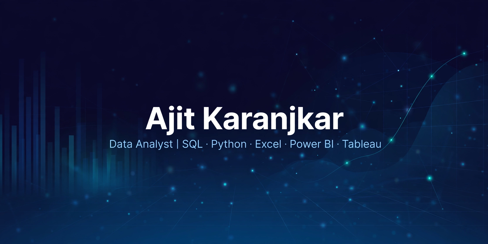

<h1 align="center">Hi, I'm Ajit Karanjkar</h1>

  

  
  

## Tech Stack

## GitHub Stats

## What I Do

I turn operational data into accurate reports, KPI dashboards, and visualizations that support business decisions — from data cleaning and validation to trend analysis and stakeholder reporting.

## Currently

Building out my data analytics portfolio through hands-on end-to-end projects (Python, SQL, Excel, Tableau/Power BI).

## Connect

- LinkedIn: https://www.linkedin.com/in/ajit-karanjkar-160763292
- Email: ajit0440karanjkar@gmail.com
